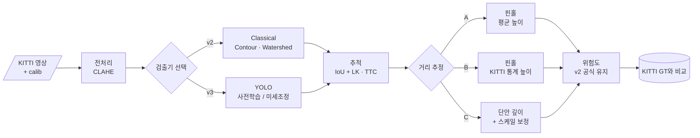

<div align="center">

# 🚘 Hybrid Forward Collision Warning

**딥러닝 검출기 + 고전 기하 파이프라인 + KITTI 정량 평가**


> 고전 영상처리로 만든 전방 충돌 경고(FCW) v2에서 **검출 단계만 딥러닝으로 교체**합니다.<br/>
> 그리고 지금까지 하지 못했던 **정답 라벨 기반 정량 평가**로 v1 · v2 · v3를 나란히 비교합니다.

</div>

> [!NOTE]
> 🚧 **계획 단계입니다.** 아직 코드가 없고, 이 README는 프로젝트 설계서입니다. 결과 수치는 실험 후 채웁니다.

---

## 📌 문제 정의

[FCW v2](https://github.com/cbnu-yhjeon/monocular-forward-collision-warning)는 딥러닝 없이 단안 카메라로 전방 위험을 등급화합니다. 하지만 두 가지 한계가 남아 있습니다.

1. **오검출**: 엣지·컨투어 기반 검출이라 도로변 수풀, 그림자, 하늘 경계를 객체로 잡습니다.
2. **평가 부재**: 공개 주행 영상 한 편으로 동작만 확인했고, 정답 라벨과 비교한 정확도가 없습니다.

## 🎯 목표

| # | 목표 | 성공 기준 |
|:---:|---|---|
| G1 | 검출기 교체가 쉬운 구조로 리팩터링 | `--detector classical \| yolo` 옵션 하나로 전환 |
| G2 | KITTI 3D 라벨로 검출 · 거리 · 위험 등급을 평가 | v1 / v2 / v3 비교표와 거리 구간별 오차 그래프 |
| G3 | 거리 오차의 원인 분해 | "박스 오차"와 "평균 높이 가정 오차"의 기여도 분리 |

### 연구 질문

- **RQ1.** 검출기만 바꿔도 위험 등급 판단(DANGER/CAUTION/SAFE)이 얼마나 좋아지는가?
- **RQ2.** 핀홀 거리 추정 오차 중 바운딩 박스 높이 오차와 클래스별 평균 높이 가정 오차가 각각 얼마나 기여하는가?
- **RQ3.** 단안 깊이 추정 모델(Depth Anything 등)을 결합하면 원거리 오차가 줄어드는가?

---

## 🔗 기반 수업과 저장소

| 수업 / 프로젝트 | 가져올 것 | 저장소 |
|---|---|---|
| 산업 컴퓨터비전 | FCW v2 파이프라인 전체: CLAHE, 차선, LK 추적, TTC, 핀홀 거리, 위험도 공식 | [monocular-forward-collision-warning](https://github.com/cbnu-yhjeon/monocular-forward-collision-warning) |
| 산업 컴퓨터비전 Lec 10 | 카메라 내부 파라미터와 핀홀 모델 `Z = H·fy / h` | [industrial_computor_vision](https://github.com/cbnu-yhjeon/industrial_computor_vision) |
| 지능화 캡스톤 (10주차) | 딥러닝 객체 탐지 실습 | [capston-pilot](https://github.com/cbnu-yhjeon/capston-pilot) |
| 딥러닝 실체 · 패턴인식 | CNN 구조와 학습 원리 | [Deep-Learning-Entities](https://github.com/cbnu-yhjeon/Deep-Learning-Entities) · [Pattern_Rcognition](https://github.com/cbnu-yhjeon/Pattern_Rcognition) |

---

## 🧭 접근 방법



1. **리팩터링:** v2의 `detection.py`를 `Detector` 인터페이스(`detect(img) → List[Detection]`)로 감쌉니다. 나머지 모듈은 그대로 둡니다.
2. **검출기 교체:** 사전학습 YOLO의 COCO 클래스(car, truck, bus, person, bicycle)를 KITTI 클래스(Car, Van, Truck, Pedestrian, Cyclist)로 매핑합니다. 필요하면 KITTI로 미세조정합니다.
3. **카메라 파라미터 교체:** v2는 실습용 카메라 값(fy = 613)을 썼습니다. v3에서는 KITTI `calib`의 `P2`에서 프레임마다 `fy`를 읽습니다.
4. **정답 위험 등급 정의:** KITTI 3D 라벨의 전방 거리 `z`와 횡방향 거리 `x`로 GT 등급을 만듭니다.

   | GT 등급 | 조건 (초안, 실험 중 조정) |
   |---|---|
   | DANGER | `z < 10 m` 이고 `\|x\| < 1.8 m` (자차 차로 안) |
   | CAUTION | `z < 25 m` 이고 `\|x\| < 3.5 m` |
   | SAFE | 그 외 |

5. **평가:** 검출, 거리, 위험 등급, 속도를 각각 측정합니다.

---

## 🗂️ 데이터

| 데이터 | 용도 | 비고 |
|---|---|---|
| [KITTI Object Detection](https://www.cvlibs.net/datasets/kitti/eval_object.php) | 검출·거리·위험 등급 평가 | 학습용 7,481장에 2D/3D 라벨, 프레임별 `calib` |
| [KITTI Tracking](https://www.cvlibs.net/datasets/kitti/eval_tracking.php) | TTC 평가 (연속 프레임) | 학습 시퀀스 21개 |
| 공개 대시캠 영상 (v2와 동일) | 정성 비교 | `Data/open_dataset/` |

> KITTI는 **CC BY-NC-SA 3.0**(비상업)입니다. 원본 데이터는 저장소에 넣지 않고, 다운로드 스크립트만 둡니다.

---

## 🧪 실험 설계

| ID | 검출 | 거리 | 추적 | 목적 |
|:---:|---|---|:---:|---|
| E0 | v1 (Contour) | 면적 기반 | — | 기준선 |
| E1 | v2 (Contour + Watershed) | 핀홀 · 평균 높이 | ✅ | 현재 버전 |
| E2 | YOLO | 핀홀 · 평균 높이 | ✅ | RQ1 |
| E3 | YOLO | 핀홀 · KITTI 클래스별 높이 통계 | ✅ | RQ2 |
| E4 | YOLO | 단안 깊이 + 핀홀로 스케일 보정 | ✅ | RQ3 |
| E5 | GT 박스 | 핀홀 · 평균 높이 | — | RQ2: 박스 오차를 0으로 둔 상한선 |

### 지표

| 영역 | 지표 |
|---|---|
| 검출 | AP@0.5 (Car, Pedestrian), 프레임당 오검출 수 |
| 거리 | 절대 오차 MAE, 상대 오차 `\|ẑ − z\| / z`, 구간별(0–10 / 10–20 / 20–40 / 40 m+) |
| 위험 등급 | Macro-F1, 혼동행렬, **DANGER 재현율**(가장 중요) |
| TTC | GT 3D 위치로 계산한 TTC 대비 MAE (TTC < 5 s 구간) |
| 속도 | FPS (CPU / GPU) |

---

## 🗓️ 마일스톤

| 주차 | 내용 | 산출물 |
|:---:|---|---|
| 1 | v2 코드 이식, `Detector` 인터페이스 리팩터링 | `--detector classical` 동작 |
| 2 | KITTI 로더, GT 위험 등급 생성, 평가 스크립트 | `eval/kitti_eval.py`, E0 · E1 결과 |
| 3 | YOLO 연동, 클래스 매핑 | E2 결과 |
| 4 | 클래스별 높이 통계, GT 박스 실험 | E3 · E5 결과, RQ2 분석 |
| 5 | 단안 깊이 모델 연동, 스케일 보정 | E4 결과 |
| 6 | Tracking 시퀀스로 TTC 평가 | TTC 오차 표 |
| 7 | 오류 사례 분석, 결과 정리 | 실패 사례 갤러리, 최종 비교표 |

---

## 📁 디렉토리 구조 (계획)

```
Hybrid-Forward-Collision-Warning/
├── configs/              실험별 설정 (E0 ~ E5)
├── scripts/
│   ├── download_kitti.sh
│   └── run_experiment.py
├── src/
│   ├── detectors/        classical.py · yolo.py (공통 Detector 인터페이스)
│   ├── distance/         pinhole.py · mono_depth.py
│   ├── pipeline/         v2에서 가져온 전처리 · 차선 · 추적 · 위험도
│   └── eval/             kitti_eval.py · gt_risk.py
├── results/              실험 결과 (metrics.json, 그래프)
└── README.md
```

## ⚠️ 리스크와 대응

| 리스크 | 대응 |
|---|---|
| COCO와 KITTI의 클래스 정의 차이 (Van, Cyclist) | 매핑 표를 고정하고 평가에서 Van은 Car로 합산 |
| 가려짐·잘림 객체 때문에 박스 높이가 실제보다 작음 | KITTI `occluded` · `truncated` 필드로 구간을 나눠 평가 |
| 단안 깊이는 상대 깊이라 스케일이 없음 | 가까운 차량의 핀홀 거리로 프레임별 스케일을 맞춤 |

## 📚 참고 자료

- A. Geiger et al., *Are we ready for Autonomous Driving? The KITTI Vision Benchmark Suite*, CVPR 2012
- [Ultralytics YOLO](https://github.com/ultralytics/ultralytics)
- L. Yang et al., *Depth Anything V2*, 2024 · [GitHub](https://github.com/DepthAnything/Depth-Anything-V2)
- 이전 버전: [Detection-and-Risk-Classification](https://github.com/cbnu-yhjeon/Detection-and-Risk-Classification) (v1) · [Forward-Collision-Warning-System](https://github.com/cbnu-yhjeon/Forward-Collision-Warning-System) (v2)
