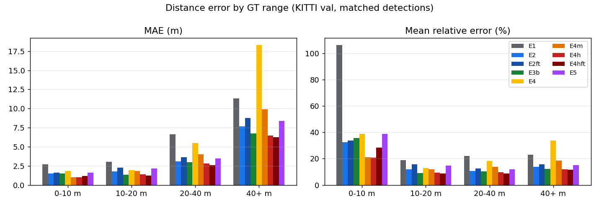
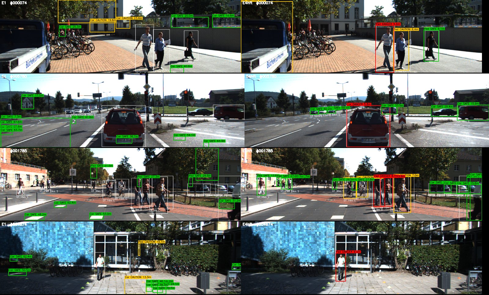
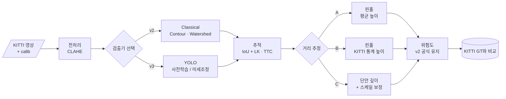

<div align="center">

# 🚘 Hybrid Forward Collision Warning

**딥러닝 검출기 + 고전 기하 파이프라인 + KITTI 정량 평가**


> 고전 영상처리로 만든 전방 충돌 경고(FCW) v2에서 **검출 단계만 딥러닝으로 교체**합니다.<br/>
> 그리고 지금까지 하지 못했던 **정답 라벨 기반 정량 평가**로 v1 · v2 · v3를 나란히 비교합니다.

</div>

> [!NOTE]
> ✅ **v3 구현 · 평가 완료 (2026-10-30).** 모든 수치는 KITTI Object val 분할 3,741장(학습에 쓰지 않은 절반)에서 얻었습니다.
> 전체 표와 그래프는 [`results/summary.md`](results/summary.md)에 있습니다.

---

## 📌 문제 정의

[FCW v2](https://github.com/cbnu-yhjeon/monocular-forward-collision-warning)는 딥러닝 없이 단안 카메라로 전방 위험을 등급화합니다. 하지만 두 가지 한계가 남아 있습니다.

1. **오검출**: 엣지·컨투어 기반 검출이라 도로변 수풀, 그림자, 하늘 경계를 객체로 잡습니다.
2. **평가 부재**: 공개 주행 영상 한 편으로 동작만 확인했고, 정답 라벨과 비교한 정확도가 없습니다.

## 🎯 목표

| # | 목표 | 성공 기준 |
|:---:|---|---|
| G1 | 검출기 교체가 쉬운 구조로 리팩터링 | `--detector classical \| yolo` 옵션 하나로 전환 |
| G2 | KITTI 3D 라벨로 검출 · 거리 · 위험 등급을 평가 | v1 / v2 / v3 비교표와 거리 구간별 오차 그래프 |
| G3 | 거리 오차의 원인 분해 | "박스 오차"와 "평균 높이 가정 오차"의 기여도 분리 |

### 연구 질문

- **RQ1.** 검출기만 바꿔도 위험 등급 판단(DANGER/CAUTION/SAFE)이 얼마나 좋아지는가?
- **RQ2.** 핀홀 거리 추정 오차 중 바운딩 박스 높이 오차와 클래스별 평균 높이 가정 오차가 각각 얼마나 기여하는가?
- **RQ3.** 단안 깊이 추정 모델(Depth Anything 등)을 결합하면 원거리 오차가 줄어드는가?

---

## 📊 결과 요약

| ID | 검출 | 거리 | Car AP | FP/frame | 거리 상대 오차 | 잘린 객체 오차 | 위험 등급 Macro-F1<br/>(프레임, 기하 규칙) | DANGER 재현율<br/>(프레임) |
|:---:|---|---|:---:|:---:|:---:|:---:|:---:|:---:|
| E0 | v1 Contour | 면적 | 0.00 | 6.32 | — | — | — | — |
| E1 | v2 Contour+Watershed | 핀홀 · 평균 높이 | 0.00 | 6.04 | 40.3% | 92.3% | 0.304 | 0.060 |
| E2 | YOLO11m (COCO) | 핀홀 · 평균 높이 | **0.903** | 0.99 | 15.0% | 41.2% | 0.800 | 0.967 |
| E3a | YOLO11m | 핀홀 · 클래스별 3D 평균 높이 | 0.903 | 0.99 | 13.8% | 46.2% | 0.855 | 0.957 |
| E3b | YOLO11m | 핀홀 · YOLO 박스로 보정한 유효 높이 | 0.903 | 0.99 | 14.3% | 48.8% | **0.869** | 0.951 |
| E4m | YOLO11m | Depth Anything V2 Metric + 스케일 보정 | 0.903 | 0.99 | 15.4% | **26.4%** | 0.859 | 0.913 |
| **E4h** | YOLO11m | **잘린 박스만 깊이, 나머지 핀홀** | 0.903 | 0.99 | **11.7%** | 26.5%¹ | 0.860 | 0.957 |
| E5 | GT 박스 | 핀홀 · 평균 높이 | 1.000 | 0.00 | 17.3% | 45.4% | 0.770 | 0.995 |
| E2ft | YOLO11m KITTI 미세조정 | 핀홀 · 평균 높이 | **0.973** | **0.28** | 17.1%² | 39.9% | 0.772 | **0.989** |
| E3bft | YOLO11m KITTI 미세조정 | 핀홀 · 미세조정 박스로 보정한 유효 높이 | 0.973 | 0.28 | 13.0%² | 43.8% | 0.894 | 0.973 |
| **E4hft** | **YOLO11m KITTI 미세조정** | **보정 높이 핀홀 + 잘린 박스만 깊이** | 0.973 | 0.28 | 12.2%² | 35.9% | **0.898** | 0.967 |

¹ 경계에 닿은 박스만 깊이를 쓰므로 잘림 > 0.15 구간은 E4m과 거의 같습니다.
² 미세조정 모델은 가려지거나 잘린 어려운 객체를 더 많이 잡아 매칭 쌍이 17,896개(사전학습 16,178개)라 거리 오차를 사전학습 행과 직접 비교할 수는 없습니다.
전체 실험(E3, E4, E4m_raw 포함)·구간별 오차·TTC·속도는 [`results/summary.md`](results/summary.md).

**최종 시스템은 E4hft입니다.** KITTI로 미세조정한 YOLO11m이 검출을 맡고, 거리는 그 검출기 박스로 보정한 높이를 쓴 핀홀로 추정하되 화면 경계에 걸린 박스만 Depth Anything V2 미터 깊이로 바꿉니다. 위험 등급은 추정한 (Z, X)에 기하 규칙을 적용합니다. v2(E1)와 비교하면 위험 등급 프레임 Macro-F1이 0.30에서 0.90으로, DANGER 재현율이 0.06에서 0.97로 오릅니다.



### 연구 질문에 대한 답

- **RQ1 — 검출기만 바꿔도 좋아지는가? → 그렇다, 압도적으로.** v2 고전 검출기는 KITTI에서 GT 객체의 1.3%만 IoU 0.5로 잡고 프레임당 6개의 오검출(수풀·그림자·하늘 경계)을 냅니다. YOLO로 바꾸면 재현율 93%, 오검출 1개/프레임이 되고, 같은 기하 규칙에서 위험 등급 Macro-F1이 0.30 → 0.80, DANGER 재현율이 0.06 → 0.97로 오릅니다. KITTI train 분할로 20 에폭 미세조정하면 Car AP 0.90 → 0.97, Cyclist AP 0.30 → 0.85, 오검출 0.99 → 0.28개/프레임이 됩니다.
- **부수 발견 — v2 위험 점수 공식은 물리적 위험과 맞지 않는다.** 화면 중앙 근접도·크기·특징점으로 만든 v2 점수는 검출이 좋아지면 거의 모든 프레임을 DANGER로 판정합니다(프레임 Macro-F1 0.05, SAFE 예측 0건). 추정한 거리 (Z, X)에 GT와 같은 규칙을 적용하는 것이 훨씬 낫습니다. 그래서 위의 위험 등급 열은 기하 규칙 결과이고, v2 공식 결과는 `results/summary.md`에 그대로 남겨 두었습니다.
- **RQ2 — 거리 오차는 어디서 오는가? → 주로 "평균 높이 가정"과 "잘림".** E2의 매칭 쌍에서 로그 오차를 정확히 분해하면 산포는 높이 가정 ±17.7%, 박스 오차 ±8.3%, 2D 박스≠3D 높이 잔차 ±14.1%이고, 잔차는 0–10 m(화면 밖으로 잘린 차량)에 몰려 있습니다. 편향은 서로 상쇄됩니다(박스 +5.5%, 높이 −6.1%, 잔차 −7.5%). 그래서 GT 박스(E5)가 YOLO 박스(E2)보다 오히려 오차가 크고, GT 박스로 학습한 유효 높이(E3)는 YOLO 박스에 쓰면 과보정됩니다. **높이 통계는 추론에 쓰는 검출기의 박스로 보정해야 합니다(E3b).** 미세조정 모델에서도 같은 일이 반복됩니다. 박스가 GT처럼 커지자 평균 높이(E2ft)의 오차가 17.1%로 늘었고, 그 박스로 다시 보정하자(E3bft) 13.0%로 줄었습니다.
- **RQ3 — 단안 깊이가 원거리 오차를 줄이는가? → 원거리는 아니고, 근거리·잘린 객체에서 줄인다.** 상대 깊이 모델(E4)은 원거리 외삽에서 오차가 커져(40 m+ 33.7%) 핀홀보다 나쁩니다. 미터 깊이 모델(E4m)은 잘린 객체 오차를 46% → 26%로 줄이지만 원거리는 여전히 핀홀이 낫습니다. 두 방식을 박스가 화면 경계에 닿는지로 나눠 쓰는 하이브리드(E4h)가 전체 상대 오차 11.7%, MAE 2.98 m로 가장 좋습니다.

### TTC (KITTI Tracking 21개 시퀀스, GT TTC < 5 s)

| 방법 | 검출 | 매칭 쌍 | 커버리지 | 중앙 절대 오차 | \|오차\| < 1 s |
|---|---|:---:|:---:|:---:|:---:|
| v2 원식 `area / dArea` | v2 고전 (E1) | 215 | 44% | 1.44 s | 38% |
| v2 원식 `area / dArea` | YOLO (E3b) | 15,768 | 79% | 1.38 s | 32% |
| **박스 높이 스케일** `k·Δt/(s−1)` | YOLO (E3b) | 15,768 | 84% | **0.36 s** | **75%** |
| 핀홀 거리 차분 `Z / (−dZ/dt)` | YOLO (E3b) | 15,768 | 84% | 0.37 s | 75% |
| 단안 깊이 거리 차분 | YOLO (E4m) | 15,768 | 78% | 0.83 s | 56% |

v2 식은 면적(∝ 1/Z²)을 높이처럼 다뤄 TTC를 약 절반으로 냅니다. 스케일 식으로 고치면 오차가 1/4로 줄어듭니다. 단안 깊이는 프레임마다 스케일을 따로 맞추므로 거리가 프레임 간에 흔들려 차분 TTC에는 불리합니다. 평균 절대 오차(약 1.5 s)는 박스 높이 변화가 거의 잡히지 않아 예측이 10 s를 넘는 3%의 이상치(평균 오차 25.6 s)에 끌려 올라가므로 중앙값을 함께 봅니다. 스케일 TTC의 중앙 오차는 GT TTC가 짧을수록 작습니다: 0–1 s 구간 0.16 s, 1–2 s 0.19 s, 4–5 s 1.17 s. 경보에 가장 중요한 구간에서 가장 정확합니다.

### 속도 (val 200장, 이미지 디코딩 제외, 경합 없이 측정)

| ID | 장치 | FPS | 검출 ms | 거리 ms | 전처리 + 추적·위험도 ms |
|:---:|:---:|:---:|:---:|:---:|:---:|
| E1 v2 | CPU | 67.1 | 4.6 | 0.0 | 10.3 |
| E2 YOLO | GPU | 39.4 | 11.6 | 0.0 | 13.8 |
| E2 YOLO | CPU | 5.3 | 175.0 | 0.0 | 14.1 |
| E4 상대 깊이 (매 프레임) | GPU | 17.6 | 12.4 | 30.6 | 13.9 |
| **E4hft 최종** | GPU | **24.7** | 11.5 | 15.2 | 13.9 |
| E4hft 최종 | CPU | 1.5 | 155.8 | 517.0 | 14.8 |

RTX 5060 Ti 16GB, Core Ultra 5 245KF (WSL2). E4h/E4hft는 화면 경계에 닿은 박스가 있는 프레임(val의 약 절반)에서만 깊이 모델을 돌립니다. v2에서 이식한 Harris·SIFT·HOG 특징과 차선 검출이 CPU에서 프레임당 약 14 ms를 차지하는데, 기하 규칙 위험 등급에는 쓰이지 않으므로 다음 버전에서 걷어낼 수 있습니다.

### 질적 비교 (같은 프레임, 왼쪽 E1 v2 · 오른쪽 E4hft 최종)



흰 박스는 GT(거리와 GT 등급 첫 글자), 색 박스는 예측(초록 SAFE · 노랑 CAUTION · 빨강 DANGER).

**실패 사례.** val에서 E4hft가 DANGER 프레임을 놓친 경우는 6건이고, GT SAFE 프레임에 DANGER를 낸 경우는 0건입니다([`results/gallery/missed_danger_E1_vs_E4hft.jpg`](results/gallery/missed_danger_E1_vs_E4hft.jpg)). 놓친 6건은 거리는 맞지만(예: 7.5 m vs GT 7 m) 횡방향 거리가 문제였습니다.
- **차로 경계를 걷는 보행자:** \|X\|가 1.8 m 경계 바로 바깥으로 추정되어 CAUTION이 되었습니다.
- **화면 가장자리에서 잘린 차량:** 박스 중심이 화면 안쪽으로 치우쳐 X가 틀렸습니다.

경계에서 등급이 뚝 끊기지 않도록 히스테리시스를 두거나, X를 박스 중심 대신 박스 하단 접지점으로 추정하는 것이 다음 개선 후보입니다.

---

## 🔗 기반 수업과 저장소

| 수업 / 프로젝트 | 가져올 것 | 저장소 |
|---|---|---|
| 산업 컴퓨터비전 | FCW v2 파이프라인 전체: CLAHE, 차선, LK 추적, TTC, 핀홀 거리, 위험도 공식 | [monocular-forward-collision-warning](https://github.com/cbnu-yhjeon/monocular-forward-collision-warning) |
| 산업 컴퓨터비전 Lec 10 | 카메라 내부 파라미터와 핀홀 모델 `Z = H·fy / h` | [industrial_computor_vision](https://github.com/cbnu-yhjeon/industrial_computor_vision) |
| 지능화 캡스톤 (10주차) | 딥러닝 객체 탐지 실습 | [capston-pilot](https://github.com/cbnu-yhjeon/capston-pilot) |
| 딥러닝 실체 · 패턴인식 | CNN 구조와 학습 원리 | [Deep-Learning-Entities](https://github.com/cbnu-yhjeon/Deep-Learning-Entities) · [Pattern_Rcognition](https://github.com/cbnu-yhjeon/Pattern_Rcognition) |

---

## 🧭 접근 방법



1. **리팩터링:** v2의 `detection.py`를 `Detector` 인터페이스(`detect(img) → List[Detection]`)로 감쌉니다. 나머지 모듈은 그대로 둡니다.
2. **검출기 교체:** 사전학습 YOLO의 COCO 클래스(car, truck, bus, person, bicycle)를 KITTI 클래스(Car, Van, Truck, Pedestrian, Cyclist)로 매핑합니다. 필요하면 KITTI로 미세조정합니다.
3. **카메라 파라미터 교체:** v2는 실습용 카메라 값(fy = 613)을 썼습니다. v3에서는 KITTI `calib`의 `P2`에서 프레임마다 `fy`를 읽습니다.
4. **정답 위험 등급 정의:** KITTI 3D 라벨의 전방 거리 `z`와 횡방향 거리 `x`로 GT 등급을 만듭니다.

   | GT 등급 | 조건 (초안, 실험 중 조정) |
   |---|---|
   | DANGER | `z < 10 m` 이고 `\|x\| < 1.8 m` (자차 차로 안) |
   | CAUTION | `z < 25 m` 이고 `\|x\| < 3.5 m` |
   | SAFE | 그 외 |

5. **평가:** 검출, 거리, 위험 등급, 속도를 각각 측정합니다.

---

## 🗂️ 데이터

| 데이터 | 용도 | 비고 |
|---|---|---|
| [KITTI Object Detection](https://www.cvlibs.net/datasets/kitti/eval_object.php) | 검출·거리·위험 등급 평가 | 학습용 7,481장에 2D/3D 라벨, 프레임별 `calib` |
| [KITTI Tracking](https://www.cvlibs.net/datasets/kitti/eval_tracking.php) | TTC 평가 (연속 프레임) | 학습 시퀀스 21개 |
| 공개 대시캠 영상 (v2와 동일) | 정성 비교 | `Data/open_dataset/` |

> KITTI는 **CC BY-NC-SA 3.0**(비상업)입니다. 원본 데이터는 저장소에 넣지 않고, 다운로드 스크립트만 둡니다.

---

## 🧪 실험 설계

| ID | 검출 | 거리 | 추적 | 목적 |
|:---:|---|---|:---:|---|
| E0 | v1 (Contour) | 면적 기반 | — | 기준선 |
| E1 | v2 (Contour + Watershed) | 핀홀 · 평균 높이 | ✅ | 현재 버전 |
| E2 | YOLO | 핀홀 · 평균 높이 | ✅ | RQ1 |
| E3 | YOLO | 핀홀 · KITTI 클래스별 높이 통계 | ✅ | RQ2 |
| E4 | YOLO | 단안 깊이 + 핀홀로 스케일 보정 | ✅ | RQ3 |
| E5 | GT 박스 | 핀홀 · 평균 높이 | — | RQ2: 박스 오차를 0으로 둔 상한선 |

구현하면서 결과를 보고 추가한 실험:

| ID | 내용 | 추가한 이유 |
|:---:|---|---|
| E2ft | KITTI train 분할로 미세조정한 YOLO11m | 계획서 "필요하면 미세조정" (RQ1) |
| E3 / E3a / E3b | 높이 통계: GT 박스 기준 유효 높이 / 3D 평균 높이 / YOLO 박스 기준 유효 높이 | E3가 E2보다 나빠진 원인(박스 정의 차이) 확인 |
| E4m / E4m_raw | Depth Anything V2 **Metric-Outdoor** + 단일 스케일 보정 / 보정 없음 | 상대 깊이(E4)의 원거리 외삽 실패 |
| E4h | 경계에 닿은 박스만 미터 깊이, 나머지 핀홀 | E4m이 잘린 객체에서만 핀홀보다 나음 |
| E3bft / E4hft | 미세조정 YOLO + 그 박스로 보정한 높이 (+ 경계 융합) | 최종 시스템 조합 |

**평가 규칙 요약.** 데이터 분할은 프레임 ID를 seed 0으로 섞어 50:50(train 3,740 / val 3,741), 높이 통계·미세조정은 train만 씁니다. 검출 AP는 IoU 0.5, KITTI moderate 조건(박스 높이 ≥ 25 px, occluded ≤ 1, truncated ≤ 0.3), 40점 보간이며 DontCare 영역 검출과 Car 평가에서의 Truck은 무시합니다. 거리·위험 등급은 클래스 무관 IoU ≥ 0.5 매칭이고, 놓친 GT는 SAFE 예측, 오검출은 GT SAFE로 셉니다. 고전 검출기는 신뢰도가 없어 AP가 단일 PR 점이 되고, 재현율 2.5% 미만이면 R40 AP는 0입니다. 미세조정 모델의 높이 보정(E3bft, E4hft)은 그 모델이 학습한 train 분할에서 했으므로, 학습 이미지에서 박스가 더 정확하게 나와 보정이 약간 낙관적일 수 있습니다. 그래도 평가는 val 분할이라 수치 자체에 누수는 없습니다.

### 지표

| 영역 | 지표 |
|---|---|
| 검출 | AP@0.5 (Car, Pedestrian), 프레임당 오검출 수 |
| 거리 | 절대 오차 MAE, 상대 오차 `\|ẑ − z\| / z`, 구간별(0–10 / 10–20 / 20–40 / 40 m+) |
| 위험 등급 | Macro-F1, 혼동행렬, **DANGER 재현율**(가장 중요) |
| TTC | GT 3D 위치로 계산한 TTC 대비 MAE (TTC < 5 s 구간) |
| 속도 | FPS (CPU / GPU) |

---

## 🗓️ 마일스톤

| 주차 | 내용 | 산출물 |
|:---:|---|---|
| 1 | v2 코드 이식, `Detector` 인터페이스 리팩터링 | ✅ `--detector classical` 동작 |
| 2 | KITTI 로더, GT 위험 등급 생성, 평가 스크립트 | ✅ `eval/kitti_eval.py`, E0 · E1 결과 |
| 3 | YOLO 연동, 클래스 매핑 | ✅ E2 결과 (+ E2ft 미세조정) |
| 4 | 클래스별 높이 통계, GT 박스 실험 | ✅ E3 · E3a · E3b · E5 결과, RQ2 분석 |
| 5 | 단안 깊이 모델 연동, 스케일 보정 | ✅ E4 · E4m · E4h 결과 |
| 6 | Tracking 시퀀스로 TTC 평가 | ✅ TTC 오차 표 |
| 7 | 오류 사례 분석, 결과 정리 | ✅ 실패 사례 갤러리, 최종 비교표 |

---

## 🚀 실행 방법

```bash
uv sync --extra dev                         # Python 3.10, torch cu128, OpenCV 4.x
bash scripts/download_kitti.sh all          # ~/data/kitti (KITTI_ROOT로 변경 가능)
cp <yolo11m.pt> weights/                    # 없으면 Ultralytics가 자동 다운로드

uv run python scripts/compute_height_stats.py                     # E3/E3a 높이 통계 (train)
uv run python scripts/calibrate_detector_heights.py \
    --config configs/E2.yaml --key yolo11m                         # E3b 검출기 박스 보정 (train)
uv run python scripts/run_experiment.py --config configs/E2.yaml  # 실험 하나 (val)
uv run python scripts/run_experiment.py --config configs/E1.yaml --detector yolo   # 검출기만 교체
uv run python scripts/finetune_yolo.py                            # E2ft 가중치 (weights/yolo11m_kitti.pt)
uv run python scripts/calibrate_detector_heights.py \
    --config configs/E2ft.yaml --key yolo11m_kitti                 # E3bft/E4hft 높이 보정
uv run python scripts/run_experiment.py --config configs/E4hft.yaml  # 최종 시스템
uv run python scripts/eval_ttc.py --configs configs/E1.yaml configs/E3b.yaml configs/E4m.yaml
uv run python scripts/benchmark_speed.py --configs configs/E*.yaml [--device cpu]
uv run python scripts/make_report.py                              # results/summary.md + 그래프
uv run python scripts/make_gallery.py --a E1 --b E4hft --key risk_geo
uv run python scripts/demo.py --config configs/E4hft.yaml --kitti-seq 0001 --gt --out results/demo.mp4
uv run pytest
```

## 📁 디렉토리 구조

```
Hybrid-Forward-Collision-Warning/
├── configs/              실험별 설정 (E0 ~ E5, E2ft, E3a/b/bft, E4m/h/hft) · height_stats.json
├── scripts/              download_kitti.sh · run_experiment.py · eval_ttc.py · finetune_yolo.py
│                         compute_height_stats.py · calibrate_detector_heights.py
│                         benchmark_speed.py · make_report.py · make_gallery.py · demo.py
├── src/hfcw/
│   ├── detectors/        base.py(Detector 인터페이스) · classical.py(v1/v2) · yolo.py · gt.py
│   ├── distance/         pinhole.py · mono_depth.py (상대/미터 깊이, 스케일 보정, 경계 융합)
│   ├── pipeline/         v2 이식: preprocessing · lane · feature · tracking(TTC) · risk · fcw · visualize
│   ├── eval/             kitti_eval.py(AP·거리·위험 등급) · gt_risk.py · ttc_eval.py
│   └── data/kitti.py     Object/Tracking 로더, cam0→cam2 보정, train/val 분할
├── tests/                단위 테스트 (pytest)
├── results/              실험별 metrics.json · distance_pairs.csv, figures/, gallery/, ttc/, summary.md
└── README.md
```

### v2에서 바뀐 점

| 항목 | v2 | v3 |
|---|---|---|
| 검출 | `detection.py` 함수 호출 | `Detector` 인터페이스, 설정 한 줄로 교체 |
| 카메라 | 실습 카메라 fy = 613 고정 | 프레임마다 KITTI `P2`에서 fx, fy, cx, cy |
| 박스 좌표 | 정수 x, y, w, h | 실수 x1, y1, x2, y2 (v2 프로퍼티 호환) |
| TTC | `area / dArea` (프레임, 실제 TTC의 약 1/2) | 박스 높이 스케일 `k·Δt / (s − 1)`, 거리 차분 TTC 추가 |
| 횡방향 거리 | 없음 | `X = (u − cx)·Z / fx` |
| 위험 등급 | v2 점수 공식 | v2 공식 + 기하 규칙(GT와 같은 Z·X 임계값) 동시 출력 |

## ⚠️ 리스크와 대응

| 리스크 | 대응 |
|---|---|
| COCO와 KITTI의 클래스 정의 차이 (Van, Cyclist) | 매핑 표를 고정하고 평가에서 Van은 Car로 합산 |
| 가려짐·잘림 객체 때문에 박스 높이가 실제보다 작음 | KITTI `occluded` · `truncated` 필드로 구간을 나눠 평가 |
| 단안 깊이는 상대 깊이라 스케일이 없음 | 가까운 차량의 핀홀 거리로 프레임별 스케일을 맞춤 → 원거리 외삽이 불안정해 미터 깊이 모델 + 경계 융합(E4h)으로 대체 |
| 데이터 누수 | 높이 통계·미세조정은 train 분할만, 모든 수치는 val 분할 |
| OpenCV 5.0에서 `HOGDescriptor` 제거 | `opencv-python<5`로 고정 (v2 HOG 보행자 검출 유지) |

## 📚 참고 자료

- A. Geiger et al., *Are we ready for Autonomous Driving? The KITTI Vision Benchmark Suite*, CVPR 2012
- [Ultralytics YOLO](https://github.com/ultralytics/ultralytics)
- L. Yang et al., *Depth Anything V2*, 2024 · [GitHub](https://github.com/DepthAnything/Depth-Anything-V2)
- 이전 버전: [Detection-and-Risk-Classification](https://github.com/cbnu-yhjeon/Detection-and-Risk-Classification) (v1) · [Forward-Collision-Warning-System](https://github.com/cbnu-yhjeon/Forward-Collision-Warning-System) (v2)
