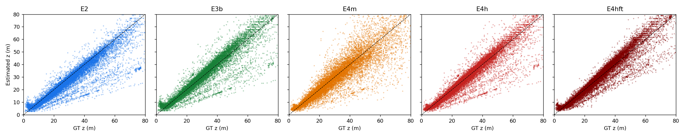
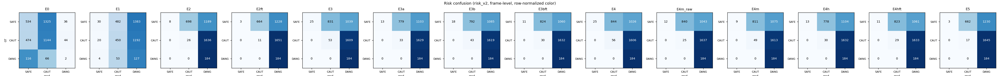
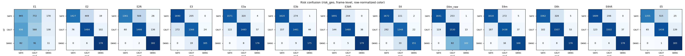
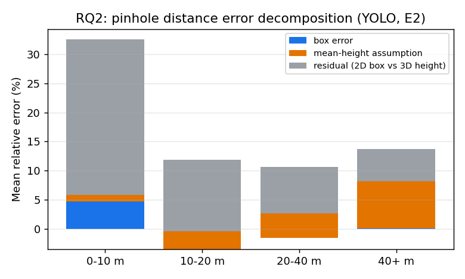

# 실험 결과 요약

KITTI Object val 분할 (3741장). `scripts/make_report.py`가 생성.

## 실험 구성

| ID | 설명 |
|:---:|:---:|
| E0 | v1 기준선 — Contour 검출, 면적 기반 위험도, 거리 추정 없음 |
| E1 | v2 현재 버전 — Contour + Watershed + HOG 보행자, 핀홀(평균 높이), KITTI P2의 fy |
| E2 | RQ1 — 검출기만 YOLO(COCO 사전학습)로 교체, 나머지는 E1과 동일 |
| E2ft | RQ1 추가 — KITTI train 분할로 미세조정한 YOLO, 나머지는 E2와 동일 |
| E3 | RQ2 — YOLO + 핀홀(KITTI train 분할의 클래스별 유효 높이 median(h_box·z/fy)) |
| E3a | E3 ablation — 클래스별 3D 높이 평균 (2D 박스 투영 효과 미보정) |
| E3b | RQ2 추가 — 높이 통계를 YOLO 박스로 train 분할에서 보정 (median(h_det·z/fy)) |
| E3bft | 미세조정 YOLO + 미세조정 YOLO 박스로 보정한 유효 높이 |
| E4 | RQ3 — YOLO + Depth Anything V2 Small(상대 깊이), 같은 프레임 핀홀 거리로 스케일 보정 |
| E4m_raw | E4m ablation — Metric-Outdoor 깊이를 스케일 보정 없이 그대로 사용 |
| E4m | RQ3 추가 — YOLO + Depth Anything V2 Metric-Outdoor Small(미터 깊이), 핀홀로 프레임별 단일 스케일 보정 |
| E4h | RQ3 하이브리드 — 화면 경계에 닿은(잘린) 박스만 미터 깊이, 나머지는 핀홀(클래스별 3D 평균 높이) |
| E4hft | 최종 시스템 — 미세조정 YOLO + 보정 높이 핀홀 + 잘린 박스만 미터 깊이 |
| E5 | RQ2 상한선 — GT 박스 + 핀홀(평균 높이). 박스 오차 0, 높이 가정 오차만 남음 |

## 검출

IoU 0.5, KITTI moderate 조건, 40점 보간 AP. 고전 검출기는 신뢰도가 없어 AP가 단일 PR 점으로 계산됩니다.

| ID | AP Car | AP Ped | AP Cyc | Precision | Recall | FP/frame |
|:---:|:---:|:---:|:---:|:---:|:---:|:---:|
| E0 | 0.000 | 0.000 | 0.000 | 0.007 | 0.014 | 6.32 |
| E1 | 0.000 | 0.000 | 0.000 | 0.006 | 0.013 | 6.04 |
| E2 | 0.903 | 0.671 | 0.298 | 0.731 | 0.931 | 0.99 |
| E2ft | 0.973 | 0.787 | 0.854 | 0.907 | 0.960 | 0.28 |
| E3 | 0.903 | 0.671 | 0.298 | 0.731 | 0.931 | 0.99 |
| E3a | 0.903 | 0.671 | 0.298 | 0.731 | 0.931 | 0.99 |
| E3b | 0.903 | 0.671 | 0.298 | 0.731 | 0.931 | 0.99 |
| E3bft | 0.973 | 0.787 | 0.854 | 0.907 | 0.960 | 0.28 |
| E4 | 0.903 | 0.671 | 0.298 | 0.731 | 0.931 | 0.99 |
| E4m_raw | 0.903 | 0.671 | 0.298 | 0.731 | 0.931 | 0.99 |
| E4m | 0.903 | 0.671 | 0.298 | 0.731 | 0.931 | 0.99 |
| E4h | 0.903 | 0.671 | 0.298 | 0.731 | 0.931 | 0.99 |
| E4hft | 0.973 | 0.787 | 0.854 | 0.907 | 0.960 | 0.28 |
| E5 | 1.000 | 1.000 | 1.000 | 1.000 | 1.000 | 0.00 |

## 거리

검출과 GT를 IoU ≥ 0.5로 매칭한 쌍에서 계산. 구간별 값은 평균 상대 오차 `|ẑ − z| / z`.

| ID | MAE (m) | 상대 오차 | 중앙값 | 0-10 m | 10-20 m | 20-40 m | 40+ m | 잘림 ≤ 0.15 | 잘림 > 0.15 | 매칭 수 |
|:---:|:---:|:---:|:---:|:---:|:---:|:---:|:---:|:---:|:---:|:---:|
| E0 | — | — | — | — | — | — | — | — | — | — |
| E1 | 5.07 | 40.3% | 18.4% | 106.2% | 19.0% | 22.0% | 23.1% | 20.6% | 92.3% | 215 |
| E2 | 3.51 | 15.0% | 8.4% | 32.5% | 11.9% | 10.7% | 13.7% | 11.7% | 41.2% | 16178 |
| E2ft | 4.09 | 17.1% | 11.6% | 33.8% | 15.6% | 12.5% | 15.7% | 14.3% | 39.9% | 17896 |
| E3 | 3.82 | 16.7% | 10.4% | 39.0% | 10.6% | 12.8% | 14.9% | 11.9% | 54.6% | 16178 |
| E3a | 3.05 | 13.8% | 6.8% | 34.7% | 9.3% | 9.6% | 11.8% | 9.8% | 46.2% | 16178 |
| E3b | 3.17 | 14.3% | 7.5% | 35.8% | 9.0% | 10.2% | 12.3% | 9.9% | 48.8% | 16178 |
| E3bft | 2.83 | 13.0% | 7.3% | 35.7% | 8.2% | 8.6% | 11.5% | 9.2% | 43.8% | 17896 |
| E4 | 6.84 | 23.5% | 13.7% | 38.8% | 13.0% | 18.3% | 33.7% | 20.2% | 49.0% | 16178 |
| E4m_raw | 3.59 | 14.0% | 10.8% | 20.7% | 13.6% | 12.2% | 13.4% | 13.4% | 18.6% | 16178 |
| E4m | 4.28 | 15.4% | 9.8% | 21.1% | 12.0% | 13.9% | 18.4% | 14.0% | 26.4% | 16178 |
| E4h | 2.98 | 11.7% | 6.8% | 20.8% | 9.4% | 9.6% | 11.8% | 9.8% | 26.5% | 16178 |
| E4hft | 2.84 | 12.2% | 7.3% | 28.5% | 8.6% | 8.8% | 11.5% | 9.3% | 35.9% | 17896 |
| E5 | 3.95 | 17.3% | 10.9% | 38.9% | 14.9% | 12.0% | 15.1% | 13.8% | 45.4% | 19741 |

## 위험 등급 — v2 점수 공식 (주 지표)

프레임 단위: 프레임의 최고 등급끼리 비교 (FCW 경보 관점). 객체 단위: 매칭 쌍 + 놓친 GT(예측 SAFE) + 오검출(GT SAFE).

| ID | 프레임 Macro-F1 | 프레임 DANGER 재현율 | 프레임 DANGER 정밀도 | 객체 Macro-F1 | 객체 DANGER 재현율 | 객체 DANGER 정밀도 |
|:---:|:---:|:---:|:---:|:---:|:---:|:---:|
| E0 | 0.305 | 0.011 | 0.024 | 0.302 | 0.000 | 0.000 |
| E1 | 0.153 | 0.690 | 0.047 | 0.230 | 0.000 | 0.000 |
| E2 | 0.048 | 1.000 | 0.061 | 0.139 | 0.967 | 0.019 |
| E2ft | 0.042 | 1.000 | 0.060 | 0.100 | 0.976 | 0.019 |
| E3 | 0.063 | 1.000 | 0.065 | 0.159 | 0.967 | 0.022 |
| E3a | 0.053 | 1.000 | 0.063 | 0.147 | 0.967 | 0.021 |
| E3b | 0.058 | 1.000 | 0.064 | 0.151 | 0.967 | 0.021 |
| E3bft | 0.052 | 1.000 | 0.064 | 0.119 | 0.976 | 0.021 |
| E4 | 0.064 | 1.000 | 0.065 | 0.134 | 0.967 | 0.019 |
| E4m_raw | 0.051 | 1.000 | 0.064 | 0.125 | 0.967 | 0.019 |
| E4m | 0.056 | 1.000 | 0.064 | 0.130 | 0.967 | 0.020 |
| E4h | 0.052 | 1.000 | 0.063 | 0.142 | 0.967 | 0.020 |
| E4hft | 0.052 | 1.000 | 0.064 | 0.117 | 0.976 | 0.021 |
| E5 | 0.044 | 1.000 | 0.060 | 0.052 | 1.000 | 0.019 |

## 위험 등급 — 추정 (Z, X)에 GT 규칙 적용 (보조 지표)

프레임 단위: 프레임의 최고 등급끼리 비교 (FCW 경보 관점). 객체 단위: 매칭 쌍 + 놓친 GT(예측 SAFE) + 오검출(GT SAFE).

| ID | 프레임 Macro-F1 | 프레임 DANGER 재현율 | 프레임 DANGER 정밀도 | 객체 Macro-F1 | 객체 DANGER 재현율 | 객체 DANGER 정밀도 |
|:---:|:---:|:---:|:---:|:---:|:---:|:---:|
| E1 | 0.304 | 0.060 | 0.034 | 0.310 | 0.000 | 0.000 |
| E2 | 0.800 | 0.967 | 0.595 | 0.773 | 0.919 | 0.553 |
| E2ft | 0.772 | 0.989 | 0.529 | 0.771 | 0.962 | 0.501 |
| E3 | 0.867 | 0.897 | 0.873 | 0.816 | 0.823 | 0.839 |
| E3a | 0.855 | 0.957 | 0.743 | 0.818 | 0.904 | 0.711 |
| E3b | 0.869 | 0.951 | 0.795 | 0.825 | 0.900 | 0.758 |
| E3bft | 0.894 | 0.973 | 0.825 | 0.862 | 0.933 | 0.796 |
| E4 | 0.845 | 0.821 | 0.863 | 0.752 | 0.770 | 0.809 |
| E4m_raw | 0.815 | 0.554 | 0.879 | 0.762 | 0.498 | 0.825 |
| E4m | 0.859 | 0.913 | 0.800 | 0.809 | 0.852 | 0.736 |
| E4h | 0.860 | 0.957 | 0.752 | 0.832 | 0.904 | 0.719 |
| E4hft | 0.898 | 0.967 | 0.828 | 0.874 | 0.928 | 0.798 |
| E5 | 0.770 | 0.995 | 0.527 | 0.787 | 0.986 | 0.520 |

## RQ2 — 거리 오차 분해 (E2 YOLO 박스)

같은 매칭 쌍에서 박스 높이(예측/GT)와 실제 높이(평균/GT)를 바꿔 끼워 평균 상대 오차를 계산하고, 두 요인 기여를 Shapley 방식으로 나눴습니다.

| 구간 | n | 전체 (E2) | 박스 오차 제거 | 높이 오차 제거 | 잔차 | 박스 기여 | 높이 가정 기여 |
|:---:|:---:|:---:|:---:|:---:|:---:|:---:|:---:|
| 0-10 | 2566 | 32.5% | 28.3% | 31.9% | 26.7% | 4.7% | 1.1% |
| 10-20 | 4044 | 11.9% | 15.5% | 9.1% | 12.3% | -3.4% | 3.0% |
| 20-40 | 6005 | 10.7% | 12.4% | 6.8% | 7.9% | -1.5% | 4.2% |
| 40+ | 3561 | 13.7% | 14.4% | 6.4% | 5.5% | 0.1% | 8.1% |
| all | 16176 | 15.1% | 16.2% | 11.3% | 11.5% | -0.6% | 4.3% |

절댓값 기준 분해는 부호가 반대인 오차끼리 상쇄되면 기여가 음수로 나올 수 있습니다. 그래서 로그 비율 `log(ẑ/z) = log(H_mean/H) + log(h_gt/h_pred) + log(z_D/z)`의 정확한 가법 분해도 함께 봅니다. 평균은 편향(+면 과대추정), 표준편차는 산포입니다.

| 구간 | 전체 편향 ± 산포 | 높이 가정 | 박스 | 잔차 (2D 박스 ≠ 3D 높이) |
|:---:|:---:|:---:|:---:|:---:|
| 0-10 | +7.6 ± 37.0 | -3.8 ± 13.3 | +10.3 ± 8.5 | +1.1 ± 31.7 |
| 10-20 | -10.0 ± 17.4 | -3.9 ± 14.0 | +7.3 ± 7.7 | -13.4 ± 7.2 |
| 20-40 | -9.5 ± 18.5 | -5.6 ± 16.7 | +4.4 ± 7.6 | -8.3 ± 3.5 |
| 40+ | -14.9 ± 24.9 | -11.1 ± 23.7 | +1.9 ± 7.9 | -5.7 ± 2.2 |
| all | -8.1 ± 24.6 | -6.1 ± 17.7 | +5.5 ± 8.3 | -7.5 ± 14.1 |

(단위: 로그 비율 × 100 ≈ %)

## 속도

`scripts/benchmark_speed.py`, val 200장, 다른 작업 없이 측정. RTX 5060 Ti 16GB / Core Ultra 5 245KF (WSL2, 12 스레드). 이미지 디코딩 제외. 고전 단계(전처리·특징)는 항상 CPU.

| ID | 장치 | FPS | 전처리 ms | 검출 ms | 거리 ms | 추적·위험도 ms | 전체 ms |
|:---:|:---:|:---:|:---:|:---:|:---:|:---:|:---:|
| E0 | GPU | 505.1 | 1.3 | 0.7 | 0.0 | 0.1 | 2.0 |
| E1 | GPU | 57.3 | 6.7 | 5.7 | 0.0 | 5.0 | 17.4 |
| E1 | CPU | 67.1 | 6.2 | 4.6 | 0.0 | 4.1 | 14.9 |
| E2 | GPU | 39.4 | 7.4 | 11.6 | 0.0 | 6.4 | 25.4 |
| E2 | CPU | 5.3 | 7.7 | 175.0 | 0.0 | 6.5 | 189.1 |
| E2ft | GPU | 38.6 | 7.5 | 11.5 | 0.0 | 7.0 | 25.9 |
| E3b | GPU | 38.6 | 7.5 | 11.8 | 0.0 | 6.6 | 25.9 |
| E4 | GPU | 17.6 | 7.5 | 12.3 | 30.6 | 6.4 | 56.8 |
| E4m | GPU | 17.7 | 7.4 | 12.0 | 30.4 | 6.7 | 56.4 |
| E4h | GPU | 25.3 | 7.2 | 11.1 | 15.1 | 6.2 | 39.5 |
| E4hft | GPU | 24.6 | 7.2 | 11.5 | 15.2 | 6.7 | 40.6 |
| E4hft | CPU | 1.4 | 7.7 | 155.8 | 517.0 | 7.1 | 687.5 |
| E5 | GPU | 73.9 | 7.1 | 0.0 | 0.0 | 6.4 | 13.5 |

## TTC (KITTI Tracking, GT TTC < 5 s)

GT TTC는 GT 트랙 z를 7프레임 창에서 직선 맞춤한 접근 속도로 계산.

| ID | 방법 | 쌍 수 | 커버리지 | MAE (s) | 중앙 AE (s) | |오차| < 1 s |
|:---:|:---:|:---:|:---:|:---:|:---:|:---:|
| E1 | ttc_v2 | 215 | 44.2% | 1.68 | 1.44 | 37.9% |
| E1 | ttc_scale | 215 | 23.7% | 1.65 | 0.82 | 56.9% |
| E1 | ttc_distance | 215 | 23.7% | 1.65 | 0.82 | 56.9% |
| E3b | ttc_v2 | 15768 | 79.4% | 1.68 | 1.38 | 32.0% |
| E3b | ttc_scale | 15768 | 84.0% | 1.50 | 0.36 | 75.2% |
| E3b | ttc_distance | 15768 | 83.8% | 1.55 | 0.37 | 74.9% |
| E4m | ttc_v2 | 15768 | 79.4% | 1.68 | 1.38 | 32.0% |
| E4m | ttc_scale | 15768 | 84.0% | 1.50 | 0.36 | 75.2% |
| E4m | ttc_distance | 15768 | 77.6% | 2.87 | 0.83 | 55.6% |
